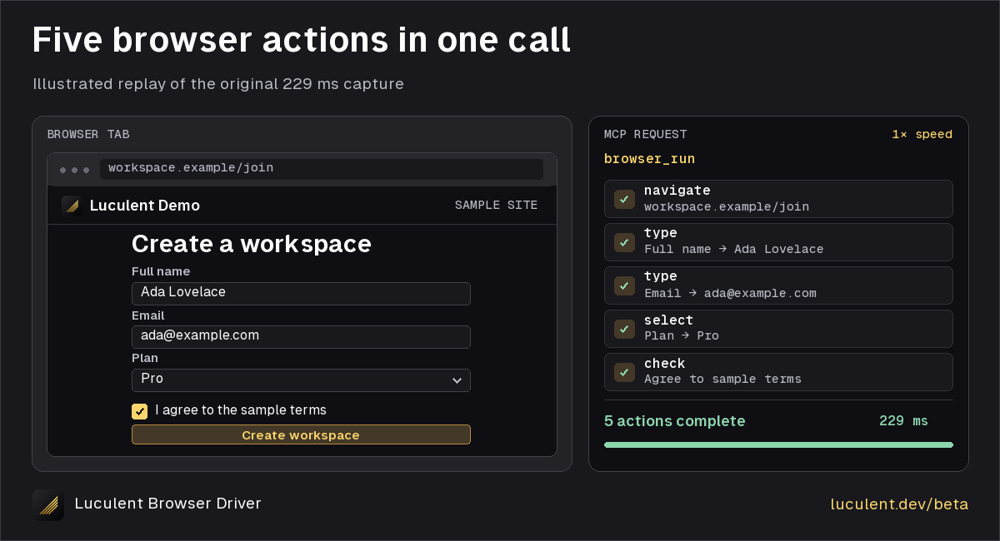

# <picture><source media="(prefers-color-scheme: dark)" srcset="store/assets/luculent-lockup-horizontal.svg"><source media="(prefers-color-scheme: light)" srcset="store/assets/luculent-lockup-horizontal-on-light.svg"></picture> Browser Driver for AI Agents

Give your AI agent a browser tab. Luculent Browser Driver connects your agent to Chrome through a local API or MCP server. Batch a form or a sequence of clicks into one call, choose which tabs the agent can use, and stop it from the toolbar.

The driver is free and open source. It’s built by [Luculent](https://luculent.dev), a toolkit for managing AI agents and keeping their work on procedure. **[Join the Luculent beta](https://luculent.dev/beta).**

<picture><source media="(prefers-reduced-motion: reduce)" srcset="store/assets/readme-browser-run-still.png"></picture>

Claude Desktop, Cursor, Codex, Gemini CLI or your own script talk to one local relay with an API key. The relay
drives your real Chrome tabs through a small MV3 extension, or a clean headless Chrome for background jobs.

```
agent --MCP / HTTP / WebSocket + API key--> relay (127.0.0.1:47800) --WebSocket--> extension --chrome.debugger--> your tabs
                                                     \------------------ CDP -----------------> headless Chrome
```

* **Fast.** `browser_run` batches many steps (navigate, type, click, wait, extract) into one call, and snapshots
  return one line per interactive element, or only what changed. No screenshots unless you ask.
* **No reconnects.** One persistent connection that survives Chrome suspending the extension's service worker.
  No "connect" tabs, no welcome pages. Agents work in tabs you already have open.
* **Secure by default.** Agents only see tabs you grant, passwords are redacted, banking sites are blocked,
  uploads need your OK, and a killswitch stops everything. See [Security](#security).
* **Works everywhere a page does.** Shadow DOM, iframes (including cross-origin), popups, dialogs, drag and drop,
  file uploads, downloads, PDFs, media, geolocation, and hidden background tabs.

## Benchmark vs Playwright MCP

Real measurements from `npm run bench` on the same local pages, same machine, same MCP stdio transport (median of
7 runs; model thinking time excluded for both). Full method: [store/BENCHMARK.md](store/BENCHMARK.md).

| Flow (local test page) | Luculent Browser Driver | Playwright MCP 0.0.85 | Speed or size difference |
|---|---|---|---|
| 7-action sign-up form, batched in one call (headless) | **131 ms** | 1,766 ms (one call per action) | **13x faster** |
| Same form in your own Chrome tab, through the extension | **159 ms** | Not measured in this configuration | — |
| 4-action search with a delayed result, batched | **156 ms** | 1,121 ms | **7x faster** |
| Text the model has to read for the form | **0.8 KB** | 4.0 KB | **5x less** |

## Quickstart

Chrome (or another supported Chromium browser) loads the extension directly. The current local relay for external HTTP and MCP clients requires Node 20+. The steps below set up that relay.

```bash
git clone https://github.com/dProFoSho/luculent-browser-driver
cd luculent-browser-driver
npm install
```

1. **Load the extension:** open `chrome://extensions`, turn on **Developer mode**, click **Load unpacked** and pick
   the `extension` folder (or install it from the Chrome Web Store).
2. **Start the relay:** `node src/cli.mjs start` (`node src/cli.mjs status` shows whether the extension connected).
3. **Mint an API key per agent:** `node src/cli.mjs keys mint --name my-agent`. The `lbd_...` key is shown once and
   stored hashed in `~/.luculent/browser-driver/`.
4. **Grant a tab:** open the extension popup on a tab and choose **Let agents use this tab**. Tabs an agent opens
   itself are granted automatically.
5. **Connect your agent** with one of the snippets below.

More detail, including the CLI and HTTP API: [QUICKSTART.md](QUICKSTART.md).

## Connect your agent

Replace `/path/to/luculent-browser-driver` with your clone and `lbd_...` with your key.

**Claude Desktop** (`claude_desktop_config.json`) and **Cursor** (`~/.cursor/mcp.json` or `.cursor/mcp.json`):
```json
{
  "mcpServers": {
    "browser": {
      "command": "node",
      "args": ["/path/to/luculent-browser-driver/src/cli.mjs", "mcp"],
      "env": { "LBD_KEY": "lbd_..." }
    }
  }
}
```

**Codex CLI** (`~/.codex/config.toml`), using the relay's Streamable HTTP endpoint:
```toml
[mcp_servers.browser]
url = "http://127.0.0.1:47800/mcp"
bearer_token_env_var = "LBD_KEY"
```

**Gemini CLI** (`~/.gemini/settings.json`):
```json
{ "mcpServers": { "browser": { "httpUrl": "http://127.0.0.1:47800/mcp", "headers": { "Authorization": "Bearer ${LBD_KEY}" } } } }
```

**Anything else** (scripts, custom agents):
```bash
curl -s http://127.0.0.1:47800/v1/rpc -H "Authorization: Bearer $LBD_KEY" -H "content-type: application/json" \
  -d '{"method":"run","params":{"steps":[{"action":"navigate","url":"https://example.com"},{"action":"extract","target":"h1"}]}}'
```

## Security

Every control is enforced by the relay, and the browser-level ones again inside the extension, so a compromised
or rogue relay still cannot reach tabs you did not grant. Change them in the extension's **Settings** page or with
`lbd policy set key=value`; each API key can only be tightened further (scopes and per-key overrides).

| Control | Default |
|---|---|
| Which tabs agents can use | **Only tabs you grant** (plus tabs and popups agents open themselves) |
| Killswitch | Popup button, `Alt+Shift+K`, or `lbd kill`. Detaches every tab and refuses all calls until you resume |
| Password fields | **Blocked**: values are redacted and agents cannot type into them |
| Banking, payment and crypto sites | **Blocked** (built-in list of about 50 sites, plus any `*bank*` / credit-union host) |
| Your own block list / allow list | Empty (an allow list limits agents to those sites only) |
| Read-only mode | Off (on = agents can navigate and read but not click, type or run scripts) |
| Running custom JavaScript (`browser_eval`) | **Blocked** (can be set to Ask me or Allow) |
| Cookies, site storage | **Blocked** |
| File uploads | **Ask me** each time (Chrome notification with Allow / Deny) |
| Submitting login, password or payment forms | **Ask me** |
| Downloads | Allowed (can be turned off) |
| Browser-internal pages (`chrome://`, other extensions) | **Always blocked** |
| Local files (`file://`) | **Blocked** |
| Incognito tabs | **Blocked** |
| Raw DevTools Protocol commands | **Blocked** |
| Rate limit | 20 actions/second, 600/minute per key |
| Relay identity | The extension pins the relay it paired with and refuses impostors |
| Activity log | On: every action and refusal, viewable in the popup and with `lbd audit` (never typed text or passwords) |
| Network | Relay listens on `127.0.0.1` only, refuses browser-page origins and DNS-rebinding hosts; API keys stored hashed |

Sensitive capabilities also need the matching API key scope: a key minted with the default scopes
(`read,act,tabs,headless`) cannot upload, run JavaScript or read cookies even if Settings allow it. Add scopes such as
`upload`, `eval`, `cookies`, `storage`, `passwords`, `files` or `cdp` with `keys mint --scopes`.

Agents get a clear "Blocked by your Luculent security settings" error when they hit a control, and are told not to
work around it. Report vulnerabilities privately: see [SECURITY.md](SECURITY.md).

## Tools

`browser_run` (batched steps), `browser_tabs`, `browser_snapshot`, `browser_navigate`, `browser_click`,
`browser_type`, `browser_press`, `browser_hover`, `browser_scroll`, `browser_select`, `browser_check`,
`browser_upload`, `browser_eval`, `browser_wait`, `browser_extract`, `browser_cookies`, `browser_storage`,
`browser_downloads`, `browser_history`, `browser_dialog`, `browser_screenshot`, `browser_parallel`,
`browser_headless`. `browser_run` steps also cover drag, wheel, tables, media, PDFs, geolocation and permissions.

Targets: `e12` (a ref from a snapshot), `text=Sign in`, `role=button[name="Search"]`, `label=Email`, or CSS.

## Tested on real sites

The broad suite (`node harness/broad.mjs`) runs 92 checks against public test sites (the-internet, UI Testing
Playground, DemoQA, TodoMVC, Wikipedia, MDN, GitHub, Hacker News, CodePen and more) and local fixtures, through
both headless Chrome and the extension. Results: [harness/RESULTS.md](harness/RESULTS.md).


## FAQ

### What is this banner?

Chrome sometimes shows a bar that says this extension "is debugging this browser." Chrome shows that bar for any extension that can control a window. It cannot be hidden. It only means an AI agent is allowed to control that window — not that your computer is being hacked, and not that anything is being sent off your machine. To stop it, press the killswitch in the popup (or Alt+Shift+K), or click Cancel on the banner.

## Development

```bash
npx playwright install chromium   # browser for the tests
npm test                          # unit, security and end-to-end tests (headless + extension)
npm run bench -- --iters 7        # benchmark vs Playwright MCP
node harness/broad.mjs            # real-site suite (add --source extension to drive the extension)
npm run package                   # Chrome Web Store zip in dist/
```

See [CONTRIBUTING.md](CONTRIBUTING.md). Licensed [MIT](LICENSE).

---

**Built by Luculent.** Your SOPs, enforced in the AI agents and tools you already use.
**[Join the beta at luculent.dev/beta](https://luculent.dev/beta)**
