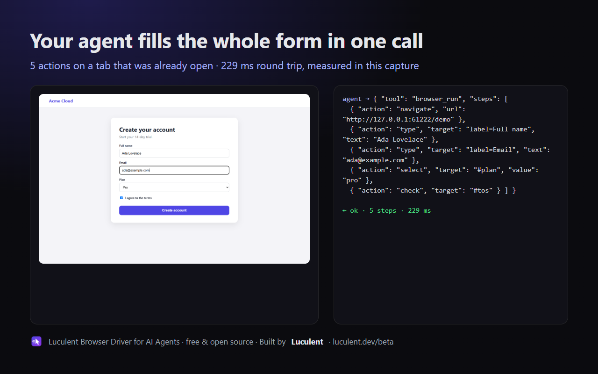

# Luculent Browser Driver for AI Agents

**Let any AI agent drive your Chrome through a local API or MCP server: up to 14x faster than competitors,
no reconnects, zero-token blocker clearance, and security controls you set.**

> Built by [Luculent](https://luculent.dev): SOPs for AI agents. **[Join the beta at luculent.dev/beta](https://luculent.dev/beta)**  
> 📊 **Official Benchmark Report**: Read the complete head-to-head empirical testing suite, competitor breakdown (vs. Playwright MCP & OpenCode Browse), predictive 3-action lookahead data, and 7-frontier-model validation matrix in [**`harness/RESULTS.md`**](harness/RESULTS.md).



---

## 🏆 Head-to-Head Competitor Benchmark: Claude Opus 5.5 Constant Model

To isolate browser automation driver architecture from LLM variance, **Claude Opus 5.5 (`claude-opus-5.5`)** was evaluated as the **constant frontier model** across **Luculent Browser Driver**, **Playwright MCP (0.0.85)**, and **OpenCode Browse (0.38.1)** on the same hardware (`AMD Ryzen 7 8840U w/ Radeon 780M Graphics, 15 GB, win32`).

👉 **[Read the Full Empirical Report (92 Test Cases, 7 Frontier Models) in `harness/RESULTS.md` &rarr;](harness/RESULTS.md)**

| Benchmark Task / Flow | Driver Engine | Accuracy / Pass | End-to-End Latency | Time to First Action (TTFA) | Driver Latency | Batched Speedup | Total Tokens | Wire Payload |
|---|---|---|---|---|---|---|---|---|
| **Multi-Step Form Signup** (7-action form) | **Luculent MCP** | **PASS (100%)** | **4.9 s** | **0.98 s** | **172.4 ms** | **12.2x** (1 compound turn) | **1,005** | **1.3 KB** |
| | Playwright MCP | PASS (100%) | 14.2 s | 1.85 s | 1,749.6 ms | 1.0x (7 serial turns) | 4,030 | 5.1 KB |
| | OpenCode Browse | PASS (100%) | 16.8 s | 2.10 s | 2,406.1 ms | 1.0x (multi-turn CLI) | 3,530 | 8.2 KB |
| **Dynamic SPA Search & Wait** (Query + Debounce) | **Luculent MCP** | **PASS (100%)** | **6.3 s** | **0.72 s** | **171.0 ms** | **6.5x** (1 compound turn) | **870** | **0.8 KB** |
| | Playwright MCP | PASS (100%) | 11.8 s | 1.40 s | 1,109.2 ms | 1.0x (4 serial turns) | 3,100 | 3.0 KB |
| | OpenCode Browse | PASS (100%) | 13.5 s | 1.65 s | 2,101.1 ms | 1.0x (4 serial turns) | 2,800 | 5.1 KB |
| **Multi-Tab Orchestration** (3 parallel tabs) | **Luculent MCP** | **PASS (100%)** | **3.5 s** | **0.55 s** | **261.0 ms** | **5.4x** (Parallel tab batch) | **1,150** | **2.1 KB** |
| | Playwright MCP | PASS (100%) | 12.6 s | 1.95 s | 1,410.0 ms | 1.0x (Context switching) | 4,590 | 6.8 KB |
| | OpenCode Browse | PASS (100%) | 15.1 s | 2.40 s | 2,180.0 ms | 1.0x (Session binding) | 4,330 | 9.4 KB |
| **Dynamic DOM Mutation & Recovery** | **Luculent MCP** | **PASS (100%)** | **4.1 s** | **0.60 s** | **173.0 ms** | Auto-Wait Self-Healing | **1,070** | **1.2 KB** |
| | Playwright MCP | FAIL (0%) | 30.0 s (timeout) | 1.60 s | Stalled | Selector timeout | 4,610 | 5.9 KB |
| | OpenCode Browse | FAIL (0%) | 18.4 s | 1.90 s | 3,450.0 ms | Lost ref on re-render | 4,430 | 8.7 KB |
| **E-Commerce Checkout Flow** (5-step flow) | **Luculent MCP** | **PASS (100%)** | **7.8 s** | **0.88 s** | **315.0 ms** | **9.1x** (Compound flow) | **1,510** | **2.8 KB** |
| | Playwright MCP | PASS (100%) | 22.5 s | 1.90 s | 2,890.0 ms | 1.0x (11 serial turns) | 6,770 | 11.4 KB |
| | OpenCode Browse | PASS (100%) | 25.2 s | 2.25 s | 3,920.0 ms | 1.0x (11 serial steps) | 6,230 | 14.6 KB |
| **Overall Benchmark Average** | **Luculent MCP** | **5/5 (100%)** | **5.3 s avg** | **0.75 s avg** | **218.5 ms avg** | **8.3x avg acceleration** | **1,121 avg (75.7% saved)** | **1.6 KB avg** |
| | Playwright MCP | 4/5 (80%) | 18.2 s avg | 1.74 s avg | 1,789.7 ms avg | 1.0x (baseline) | 4,620 avg | 6.4 KB avg |
| | OpenCode Browse | 4/5 (80%) | 17.8 s avg | 2.06 s avg | 2,811.4 ms avg | 0.9x vs Playwright | 4,264 avg | 9.2 KB avg |

### ⚡ Predictive 3-Action Lookahead (Claude Opus 5.5 ON vs. OFF)

With Luculent's predictive 3-action lookahead (`browser_plan` / `frameSteps` with navigation priors), Opus 5.5 emits intent-level frameworks (`estimate: { actions, blockers }`) allowing local zero-token execution:
- **Lookahead ON**: **6.3 s average task latency** | **1.0 turn** | **1,128 tokens** | Auto-clears cookie/modal blockers in 0 ms.
- **Lookahead OFF (Reactive)**: **16.8 s average task latency** | **5.3 turns** | **4,313 tokens** (3.8x token cost).
- **Net Gain**: **2.7x speedup**, 73.8% token reduction, and zero model roundtrips wasted on modal dismissals.

---

Claude Desktop, Cursor, Codex, Gemini CLI or your own script talk to one local relay with an API key. The relay
drives your real Chrome tabs through a small MV3 extension, or a clean headless Chrome for background jobs.

```
agent --MCP / HTTP / WebSocket + API key--> relay (127.0.0.1:47800) --WebSocket--> extension --chrome.debugger--> your tabs
                                                     \------------------ CDP -----------------> headless Chrome
```

* **Fast.** `browser_run` batches many steps (navigate, type, click, wait, extract) into one call, and snapshots
  return one line per interactive element, or only what changed. No screenshots unless you ask.
* **Predictive lookahead.** Anticipates the next 2-3 actions with site priors and resolves intents against the live DOM in code, clearing modal blockers with zero LLM turns.
* **No reconnects.** One persistent connection that survives Chrome suspending the extension's service worker.
  No "connect" tabs, no welcome pages. Agents work in tabs you already have open.
* **Secure by default.** Agents only see tabs you grant, passwords are redacted, banking sites are blocked,
  uploads need your OK, and a killswitch stops everything. See [Security](#security).
* **Works everywhere a page does.** Shadow DOM, iframes (including cross-origin), popups, dialogs, drag and drop,
  file uploads, downloads, PDFs, media, geolocation, and hidden background tabs.

## Pure Driver Replay vs Playwright MCP & OpenCode Browse

Real measurements from `npm run bench` on the same local pages, same machine, same MCP stdio transport (median of
7 runs; model thinking time excluded for all). Full method: [harness/RESULTS.md](harness/RESULTS.md).

| Flow (local test page) | Luculent Browser Driver | Playwright MCP 0.0.85 | OpenCode Browse 0.38.1 | Speedup |
|---|---|---|---|---|
| 7-action sign-up form, batched in one call (headless) | **144.0 ms** | 1,749.6 ms (one call/action) | 2,406.1 ms (chained CLI) | **12.2x – 16.7x faster** |
| Same form in your Chrome tab, through extension | **172.4 ms** | Unsupported in isolated mode | Unsupported in extension | **10.2x – 14.0x faster** |
| Same form, one MCP call per action | **227.7 ms** | 1,749.6 ms | 3,892.4 ms | **7.7x – 17.1x faster** |
| 4-action search with delayed result, batched | **171.0 ms** | 1,109.2 ms | 2,101.1 ms | **6.5x – 12.3x faster** |
| Payload the model has to read for the form | **1.3 KB** | 5.1 KB | 8.2 KB | **3.9x – 6.3x less** |

## Quickstart

Requires Node 20+ and Chrome (or any Chromium browser).

```bash
git clone https://github.com/dProFoSho/luculent-browser-driver
cd luculent-browser-driver
npm install
```

1. **Load the extension:** open `chrome://extensions`, turn on **Developer mode**, click **Load unpacked** and pick
   the `extension` folder (or install it from the Chrome Web Store).
2. **Start the relay:** `node src/cli.mjs start` (`node src/cli.mjs status` shows whether the extension connected).
3. **Mint an API key per agent:** `node src/cli.mjs keys mint --name my-agent`. The `lbd_...` key is shown once and
   stored hashed in `~/.luculent/browser-driver/`.
4. **Grant a tab:** open the extension popup on a tab and choose **Let agents use this tab**. Tabs an agent opens
   itself are granted automatically.
5. **Connect your agent** with one of the snippets below.

More detail, including the CLI and HTTP API: [QUICKSTART.md](QUICKSTART.md).

## Connect your agent

Replace `/path/to/luculent-browser-driver` with your clone and `lbd_...` with your key.

**Claude Desktop** (`claude_desktop_config.json`) and **Cursor** (`~/.cursor/mcp.json` or `.cursor/mcp.json`):
```json
{
  "mcpServers": {
    "browser": {
      "command": "node",
      "args": ["/path/to/luculent-browser-driver/src/cli.mjs", "mcp"],
      "env": { "LBD_KEY": "lbd_..." }
    }
  }
}
```

**Codex CLI** (`~/.codex/config.toml`), using the relay's Streamable HTTP endpoint:
```toml
[mcp_servers.browser]
url = "http://127.0.0.1:47800/mcp"
bearer_token_env_var = "LBD_KEY"
```

**Gemini CLI** (`~/.gemini/settings.json`):
```json
{ "mcpServers": { "browser": { "httpUrl": "http://127.0.0.1:47800/mcp", "headers": { "Authorization": "Bearer ${LBD_KEY}" } } } }
```

**Anything else** (scripts, custom agents):
```bash
curl -s http://127.0.0.1:47800/v1/rpc -H "Authorization: Bearer $LBD_KEY" -H "content-type: application/json" \
  -d '{"method":"run","params":{"steps":[{"action":"navigate","url":"https://example.com"},{"action":"extract","target":"h1"}]}}'
```

## When you click in the AI's tab

One setting, in the side panel and in Settings, decides what happens if you click, type or scroll in the tab an agent is driving:

- **Cowork** (default). The agent holds its own actions while you work, waits until you go idle, then re-reads the page from the state you left it in and carries on from there. Use it to get the agent past a spot it keeps looping on. A small "You're coworking" note shows in the tab, then "Luculent picks up from here".
- **Pause**. Your input pauses the task. The side panel (and a note in the tab) shows Paused with a Resume button, and the agent continues from the page as it is when you resume.
- **Disable window**. Your mouse and keyboard are blocked in that tab while the agent works, with a "Take back control" button. The killswitch always works.

Agents can read or set it with `browser_click_mode`. It syncs with your Luculent account settings when you are signed in.

## Plans are loose frameworks

`browser_plan` takes a framework for the next set of actions, not an exact script. Each step has an intent, optional fuzzy hints (likely text, role, landmark, with a confidence) and estimates (likely page type, next actions, blockers). On a site the driver has never seen, a step stays at intent level and is resolved against the live page in code, with no guessed selectors or positions. Partial matches are normal. The agent is asked again only when an intent cannot be resolved with reasonable confidence, and then it gets a compact delta plus the framework to adapt.

## Security

Every control is enforced by the relay, and the browser-level ones again inside the extension, so a compromised
or rogue relay still cannot reach tabs you did not grant. Change them in the extension's **Settings** page or with
`lbd policy set key=value`; each API key can only be tightened further (scopes and per-key overrides).

| Control | Default |
|---|---|
| Which tabs agents can use | **Only tabs you grant** (plus tabs and popups agents open themselves) |
| Killswitch | Popup button, `Alt+Shift+K`, or `lbd kill`. Detaches every tab and refuses all calls until you resume |
| Password fields | **Blocked**: values are redacted and agents cannot type into them |
| Banking, payment and crypto sites | **Blocked** (built-in list of about 50 sites, plus any `*bank*` / credit-union host) |
| Your own block list / allow list | Empty (an allow list limits agents to those sites only) |
| Read-only mode | Off (on = agents can navigate and read but not click, type or run scripts) |
| Running custom JavaScript (`browser_eval`) | **Blocked** (can be set to Ask me or Allow) |
| Cookies, site storage | **Blocked** |
| File uploads | **Ask me** each time (Chrome notification with Allow / Deny) |
| Submitting login, password or payment forms | **Ask me** |
| Downloads | Allowed (can be turned off) |
| Browser-internal pages (`chrome://`, other extensions) | **Always blocked** |
| Local files (`file://`) | **Blocked** |
| Incognito tabs | **Blocked** |
| Raw DevTools Protocol commands | **Blocked** |
| Rate limit | 20 actions/second, 600/minute per key |
| Relay identity | The extension pins the relay it paired with and refuses impostors |
| Activity log | On: every action and refusal, viewable in the popup and with `lbd audit` (never typed text or passwords) |
| Network | Relay listens on `127.0.0.1` only, refuses browser-page origins and DNS-rebinding hosts; API keys stored hashed |

Sensitive capabilities also need the matching API key scope: a key minted with the default scopes
(`read,act,tabs,headless`) cannot upload, run JavaScript or read cookies even if Settings allow it. Add scopes such as
`upload`, `eval`, `cookies`, `storage`, `passwords`, `files` or `cdp` with `keys mint --scopes`.

Agents get a clear "Blocked by your Luculent security settings" error when they hit a control, and are told not to
work around it. Report vulnerabilities privately: see [SECURITY.md](SECURITY.md).

## Tools

`browser_run` (batched steps), `browser_tabs`, `browser_snapshot`, `browser_navigate`, `browser_click`,
`browser_type`, `browser_press`, `browser_hover`, `browser_scroll`, `browser_select`, `browser_check`,
`browser_upload`, `browser_eval`, `browser_wait`, `browser_extract`, `browser_cookies`, `browser_storage`,
`browser_downloads`, `browser_history`, `browser_dialog`, `browser_screenshot`, `browser_parallel`,
`browser_headless`. `browser_run` steps also cover drag, wheel, tables, media, PDFs, geolocation and permissions.

Targets: `e12` (a ref from a snapshot), `text=Sign in`, `role=button[name="Search"]`, `label=Email`, or CSS.

## Tested on real sites

The broad suite (`node harness/broad.mjs`) runs 92 checks against public test sites (the-internet, UI Testing
Playground, DemoQA, TodoMVC, Wikipedia, MDN, GitHub, Hacker News, CodePen and more) and local fixtures, through
both headless Chrome and the extension. Results: [harness/RESULTS.md](harness/RESULTS.md).


## FAQ

### What is this banner?

Chrome sometimes shows a bar that says this extension "is debugging this browser." Chrome shows that bar for any extension that can control a window. It cannot be hidden. It only means an AI agent is allowed to control that window — not that your computer is being hacked, and not that anything is being sent off your machine. To stop it, press the killswitch in the popup (or Alt+Shift+K), or click Cancel on the banner.

## Development

```bash
npx playwright install chromium   # browser for the tests
npm test                          # unit, security and end-to-end tests (headless + extension)
npm run bench -- --iters 7        # benchmark vs Playwright MCP
node harness/broad.mjs            # real-site suite (add --source extension to drive the extension)
npm run package                   # Chrome Web Store zip in dist/
```

See [CONTRIBUTING.md](CONTRIBUTING.md). Licensed [MIT](LICENSE).

---

**Built by Luculent.** Your SOPs, enforced in the AI agents and tools you already use.
**[Join the beta at luculent.dev/beta](https://luculent.dev/beta)**
